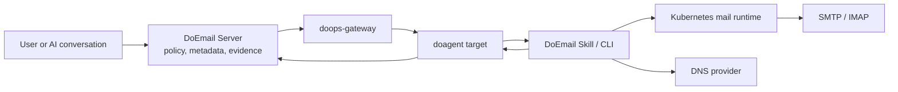

# DoEmail Architecture

DoEmail is an email-native application built on the DoOps gateway pattern.



## Components

### DoEmail Server

- Keeps mail domain, mailbox, permission and runtime metadata.
- Classifies operation risk and required grants.
- Stores operation records before execution.
- Preserves DNS, SMTP, IMAP and Kubernetes evidence.

### DoEmail Skill / CLI

- Runs from the selected doagent target.
- Applies Kubernetes mail runtime changes.
- Creates and disables mailbox accounts.
- Sends test mail and reads/searches mailbox content when permitted.
- Checks DNS records, reverse DNS, SMTP, IMAPS and runtime health.

### Kubernetes Mail Runtime

The first runtime follows the FDE `l8ai-mail` Kubernetes model:

- one mail workload for one mail hostname;
- PVCs for mail data, state and config;
- SMTP TCP 25, submission TCP 587 and IMAPS TCP 993 exposed on the mail node;
- certificate and DKIM material managed as runtime configuration.

## Proxy Rule

DoEmail operations must go through:

```text
DoEmail Server -> doops-gateway -> doagent -> DoEmail Skill / CLI -> Kubernetes mail runtime
```

If a mailbox or mail runtime is changed outside this path, DoEmail should not
claim the change as governed or audited by DoEmail.
