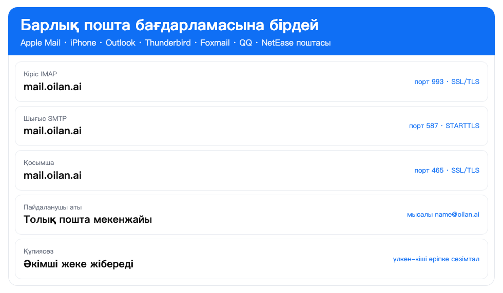
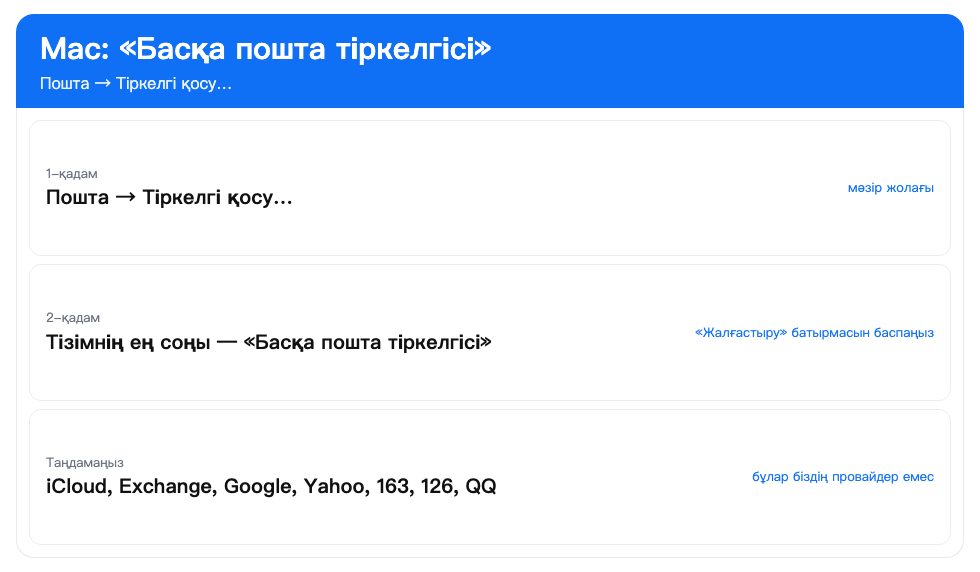
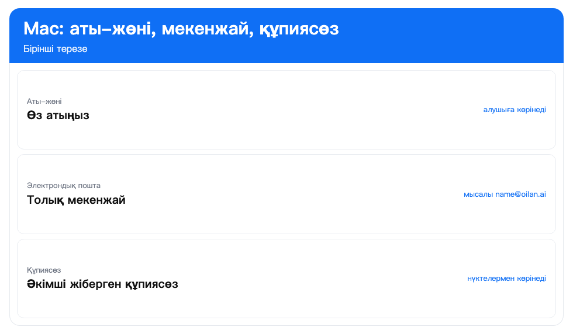
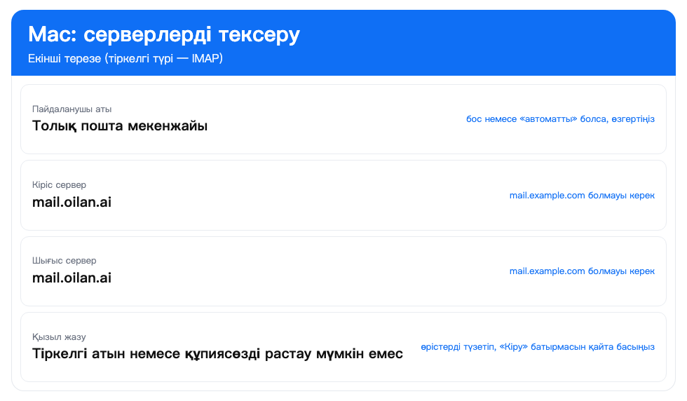
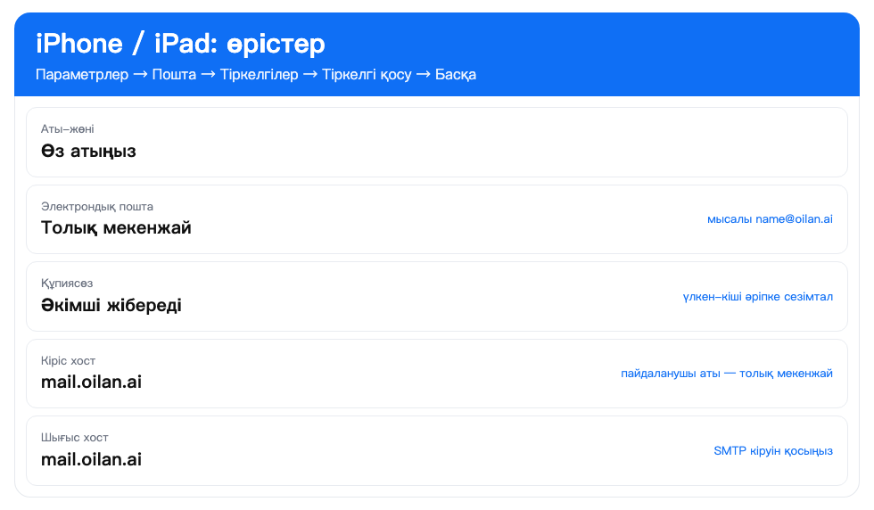
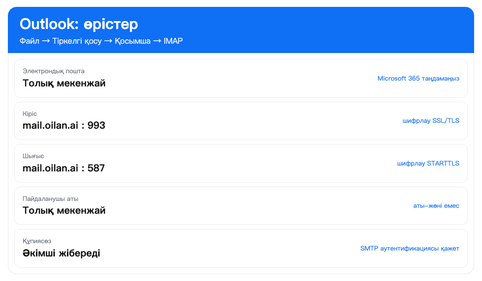
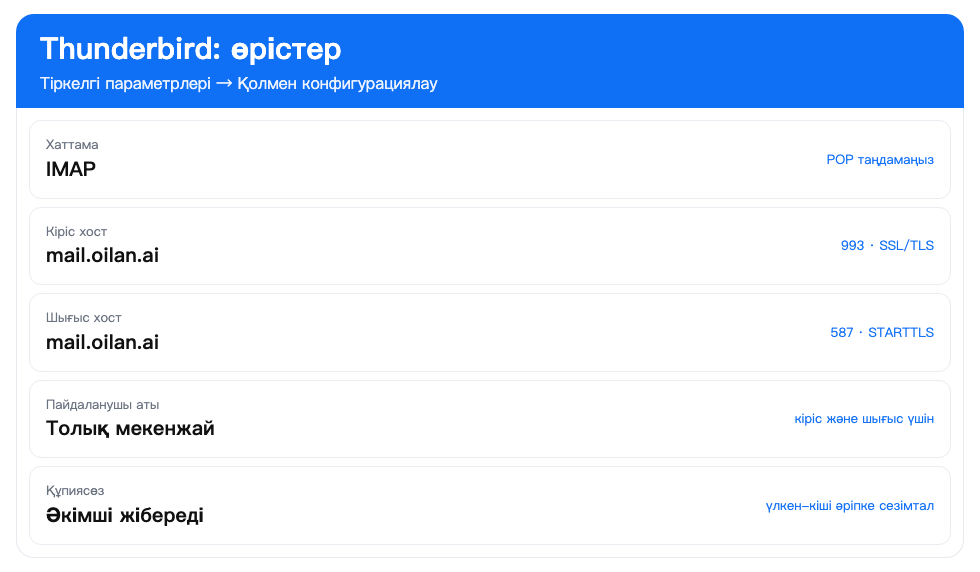

# oilan.ai поштасын пайдалану нұсқаулығы (қазақша)

> Бұл нұсқаулық **@oilan.ai** поштасын компьютерде және телефонда қалай алуға және жіберуге болатынын түсіндіреді.
>
> Нұсқаулықта құпиясөз жоқ. Пошта мекенжайы мен құпиясөзді сізге әкімші жеке жібереді. Тек өз тіркелгіңізге кіріңіз.
>
> Қытай тіліндегі нұсқасы: **oilan-ai.zh.pdf**, осы қалтада.

## 1. Сіздің тіркелгіңіз

- Пошта мекенжайы: толық мекенжай, мысалы **name@oilan.ai**. Бұл нұсқаулықта тізім жоқ; мекенжай әкімші жеке жіберген мекенжаймен дәл сәйкес болуы керек.
- Пайдаланушы аты: әр кіргенде толық мекенжай жазылады, тек аты-жөнін жазу жеткіліксіз.
- Құпиясөз: бұл нұсқаулықта жоқ, оны әкімші жеке жібереді. Құпиясөз үлкен-кіші әріпке сезімтал, басында және соңында бос орын болмауы керек.
- Құпиясөзді ұмытсаңыз немесе әріптесіңіздің хатын көру қажет болса, әкімшіге хабарласыңыз. Басқа адамның құпиясөзімен кірмеңіз.

## 2. Сервер параметрлері

Барлық клиент бірдей параметрді пайдаланады: Apple Mail, iPhone / iPad, Outlook, Thunderbird, Foxmail, QQ поштасы, NetEase поштасы. «Басқа пошта» немесе IMAP таңдаңыз; QQ нөмірімен, 163 немесе NetEase тіркелгісімен тікелей кірмеңіз.

| Мақсаты | Хост | Порт | Шифрлау |
| --- | --- | --- | --- |
| Кіріс IMAP | **mail.oilan.ai** | 993 | SSL/TLS |
| Шығыс SMTP | **mail.oilan.ai** | 587 | STARTTLS |
| Шығыс SMTP (қосымша) | **mail.oilan.ai** | 465 | SSL/TLS |

{.card}

- Пайдаланушы аты ретінде толық пошта мекенжайы жазылады.
- Шығыс поштада «SMTP аутентификациясы» қосулы болуы керек.
- Порт пен шифрлау жұп болады: 993 — SSL/TLS, 587 — STARTTLS, 465 — SSL/TLS.
- Сертификат атауы **\*.oilan.ai**. Жүйе сенім сұраса, атауын тексеріп, жалғастырыңыз.

## 3. Mac жүйесіндегі «Пошта» қолданбасына қосу

1. «Пошта» қолданбасын ашып, мәзір жолағынан «Пошта» → «Тіркелгі қосу…» тармағын таңдаңыз.
2. Тізімнің ең соңындағы «Басқа пошта тіркелгісі» тармағын таңдаңыз. iCloud, Microsoft Exchange, Google, Yahoo, AOL, 163, 126 немесе QQ поштасын таңдамаңыз. «Жалғастыру» батырмасын баспаңыз: ол мекенжай бойынша провайдерді болжайды да, қателесуі мүмкін.

{.card}

3. Аты-жөнін, толық мекенжайды және әкімші жіберген құпиясөзді енгізіп, «Кіру» батырмасын басыңыз.

{.card}

4. Келесі бетте тіркелгі түрі IMAP болып қалады. Кіріс және шығыс сервер **mail.example.com** болып тұрса, кіру сәтсіз болады және «Тіркелгі атын немесе құпиясөзді растау мүмкін емес» деген қызыл жазу шығады.

{.card}

Мына төрт өрісті өзгертіңіз:

| Өріс | Мәні |
| --- | --- |
| Электрондық пошта мекенжайы | Сіздің толық мекенжайыңыз |
| Пайдаланушы аты | Сол толық мекенжай; бос немесе «автоматты» болса, өзгертіңіз |
| Кіріс сервер | **mail.oilan.ai** |
| Шығыс сервер | **mail.oilan.ai** |

Содан кейін көк «Кіру» батырмасын басыңыз. Экрандағы қызыл жазу — **mail.example.com** тұрған кездегі ескі ескерту; өрістер дұрыс болса, ол кетеді.

5. Тіркелгі сол жақ бағанда пайда болса, хат алуға және жіберуге болады.

## 4. iPhone немесе iPad құрылғысына қосу

1. «Параметрлер» → «Пошта» → «Тіркелгілер» → «Тіркелгі қосу» тармағын ашыңыз.
2. «Басқа» → «Пошта тіркелгісін қосу». iCloud, Exchange, Google, Yahoo немесе Outlook таңдамаңыз.
3. Аты-жөнін, электрондық пошта мекенжайын және құпиясөзді толтырыңыз. Құпиясөзді әкімшіден алыңыз.
4. Келесі бетте IMAP таңдаңыз.
5. Кіріс сервер хосты: **mail.oilan.ai**; пайдаланушы аты: толық мекенжай.
6. Шығыс сервер хосты: **mail.oilan.ai**; пайдаланушы аты мен құпиясөзді қайта енгізіңіз.
7. Тек «Пошта» қосып, «Сақтау» батырмасын басыңыз.

{.card}

## 5. Outlook-қа қосу

1. Outlook-ты ашып, «Файл» → «Тіркелгі қосу» тармағын таңдаңыз.
2. «Қосымша параметрлер» немесе «Қолмен конфигурациялау» → IMAP. Microsoft 365 немесе Exchange таңдамаңыз.
3. Өрістерді төмендегідей толтырыңыз; пайдаланушы аты — толық мекенжай.
4. Шығыс поштада «SMTP аутентификациясы қажет» қосыңыз.
5. Сақтап, өзіңізге сынақ хат жіберіп, келгенін тексеріңіз.

{.card}

## 6. Thunderbird-ке қосу

1. Жаңа тіркелгі → «Электрондық пошта».
2. Толық мекенжайды және құпиясөзді енгізіп, «Қолмен конфигурациялау» тармағын таңдаңыз. Автоматты іздеу нәтижесін қолданбаңыз.
3. Кіріс: IMAP, хост **mail.oilan.ai**, порт 993, қосылым қауіпсіздігі SSL/TLS.
4. Шығыс: хост **mail.oilan.ai**, порт 587, STARTTLS; 465 пен SSL/TLS те болады.
5. Кіріс және шығыс үшін пайдаланушы аты — толық мекенжай. «Аяқтау» батырмасын басыңыз.

{.card}

## 7. Хат алу және жіберу

- Хат алу IMAP арқылы жүреді. Хаттар серверде қалады, сондықтан телефон мен компьютерде бірдей көрінеді.
- Жіберу үшін кіру қажет. Жіберуші мекенжайы кірген тіркелгімен бірдей болуы керек.
- **support@oilan.ai** мекенжайына келген хат support жәшігінде қалады және 7 тиісті әріптеске де көшіріледі; жіберуші оларды бөлек қосудың қажеті жоқ.

## 8. Жиі қойылатын сұрақтар

| Жағдай | Не істеу керек |
| --- | --- |
| Құпиясөз қате немесе растау мүмкін емес | Пайдаланушы атын толық мекенжайға, серверді **mail.oilan.ai** етіп өзгертіп, әкімші берген құпиясөзді қайта енгізіңіз. |
| Сервер mail.example.com болып тұр | Кіріс және шығыс серверді **mail.oilan.ai** етіп өзгертіңіз. |
| QQ, 163, Gmail немесе iCloud таңдалып қалды | Артқа қайтып, «Басқа пошта тіркелгісі» немесе IMAP таңдаңыз. |
| Хат аламын, бірақ жібере алмаймын | Шығыс порт 587 + STARTTLS немесе 465 + SSL/TLS; SMTP кіруін қосыңыз. |
| Сертификат туралы ескерту | Атауы \*.oilan.ai екенін тексеріп, сенім білдіріңіз. |
| Құпиясөзді ұмыттым | Әкімшіге хабарласып, қалпына келтіруді сұраңыз; әріптесіңіздің тіркелгісін пайдаланбаңыз. |

## 9. Қауіпсіздік ескертулері

- Құпиясөзді тек өзіңізге қалдырыңыз: әріптеске бермеңіз, топтық чатқа жазбаңыз.
- Ортақ компьютерде «құпиясөзді есте сақтау» қызметін қоспаңыз.
- Бейтаныс хаттағы сілтемелер мен тіркемелерді ашпаңыз.

---

Нұсқа: 2026-11-17 · Әкімші: пошта әкімшісі
