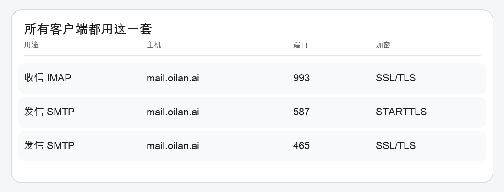
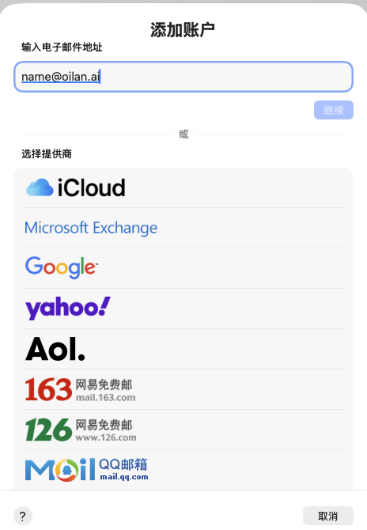
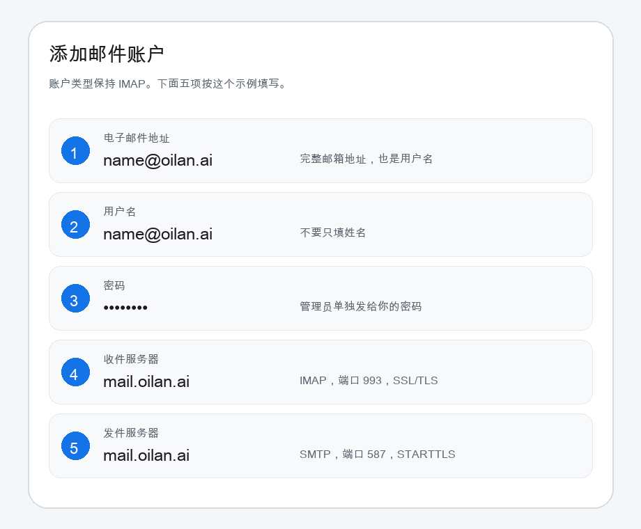

# oilan.ai 邮箱用户手册

这份手册给使用 `@oilan.ai` 邮箱的人。管理员把邮箱地址和密码单独发给你之后，按下面的步骤在自己的电脑或手机上添加账户。

用户名一律填完整邮箱地址，例如 `name@oilan.ai`。不要只填姓名。

## 服务器设置

Outlook、Mac 系统“邮件”、iPhone 邮件、Thunderbird、Foxmail、QQ 邮箱和网易邮箱大师都用这一套。不需要专有协议。

| 用途 | 主机 | 端口 | 加密 |
| --- | --- | --- | --- |
| 收信 IMAP | `mail.oilan.ai` | 993 | SSL/TLS |
| 发信 SMTP | `mail.oilan.ai` | 587 | STARTTLS |
| 发信 SMTP | `mail.oilan.ai` | 465 | SSL/TLS |

服务器使用 `*.oilan.ai` 正式证书。第一次添加时，系统如果询问是否信任，确认证书名称是 `*.oilan.ai` 后再继续。

## 在 Mac 系统“邮件”里添加

1. 打开“邮件”。
2. 点左上角菜单栏的“邮件”，选择“添加账户…”。
3. 在“输入电子邮件地址”里填完整邮箱，例如 `name@oilan.ai`。
4. 不要选 iCloud、Exchange、Google、Yahoo、AOL、163、126 或 QQ 邮箱。列表往下找到“其他邮件账户”。
5. 名称填你的显示名。电子邮件地址和用户名都填完整邮箱。密码填管理员发给你的密码。
6. 账户类型选 IMAP。收件服务器和发件服务器都填 `mail.oilan.ai`。系统窗口里如果还写着 `mail.example.com`，必须改掉。
7. 点“登录”。账户出现在左侧边栏后，就可以收信和发信。

下面这张是 Mac 系统“邮件”的实机界面。地址框里填的是示例 `name@oilan.ai`。

进入“其他邮件账户”之后，按这五项填写：

如果窗口提示“无法验证账户名或密码”，先核对这三处：

- 用户名是完整邮箱，不是姓名。
- 收件服务器和发件服务器都是 `mail.oilan.ai`。
- 密码与管理员发给你的一致，没有多余空格。

## 在 iPhone 或 iPad 上添加

1. 打开“设置”，进入“邮件”，再进入“账户”。
2. 点“添加账户”，选择“其他”，再点“添加邮件账户”。
3. 名称、电子邮件、密码、描述按自己的信息填写。电子邮件填完整地址。
4. 下一步选 IMAP。
5. 收件服务器主机名填 `mail.oilan.ai`，用户名填完整邮箱，密码再填一次。
6. 发件服务器主机名同样填 `mail.oilan.ai`，用户名和密码也填完整邮箱和同一组密码。
7. 存储点“邮件”，然后点“存储”。

## 在 Outlook 里添加

1. 打开 Outlook，选择“文件”，再选“添加账户”。
2. 点“高级设置”，选择 IMAP。
3. 收件服务器 `mail.oilan.ai`，端口 993，加密 SSL/TLS。
4. 发件服务器 `mail.oilan.ai`，端口 587，加密 STARTTLS。也可以改用 465 和 SSL/TLS。
5. 用户名填完整邮箱地址。

## 在其他常用邮箱软件里添加

Foxmail：选择“其他邮箱”，再选“手动设置”。收件服务器选 IMAP，发件服务器选 SMTP，主机、端口和加密按上面的表填写。

QQ 邮箱：选择“添加其他邮箱”，协议选 IMAP。不要用 QQ 账号登录这个邮箱。服务器填 `mail.oilan.ai`。

网易邮箱大师：选择“添加其他邮箱”，再选 IMAP。收信使用 993 和 SSL/TLS，发信使用 587 和 STARTTLS，或 465 和 SSL/TLS。

Thunderbird：新建账户时选择“手动配置”。IMAP 使用 993 和 SSL/TLS，SMTP 使用 587 和 STARTTLS。用户名填完整邮箱地址。

## 收信和发信

收信走 IMAP。邮件保留在服务器上，手机和电脑看到的是同一封信。

发信必须登录。发件人要和登录的邮箱一致。新邮件写完后点发送。对方如果收不到，先看自己的发件箱或垃圾邮件，再把退信原文交给管理员。

写给 `support@oilan.ai` 的信会留在 support 邮箱，并同时出现在已登记的同事邮箱里。这是服务器上的抄送，不需要发信人再逐个添加收件人。

## 遇到问题时

| 现象 | 处理 |
| --- | --- |
| 提示密码错误 | 用户名改成完整邮箱，再重新输入密码。 |
| 服务器仍是 `mail.example.com` | 收件和发件都改成 `mail.oilan.ai`。 |
| 选成了 QQ、163 或 iCloud | 返回，改选“其他邮件账户”。 |
| 能收信但不能发信 | 发件端口用 587 和 STARTTLS，或 465 和 SSL/TLS，并打开 SMTP 登录验证。 |
| 证书提示 | 确认名称是 `*.oilan.ai` 后再信任。 |
