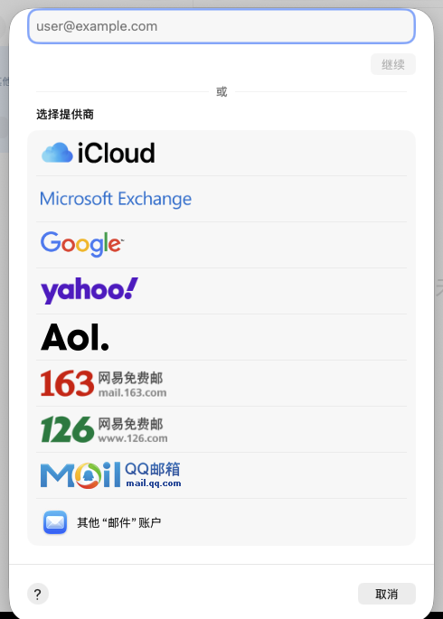
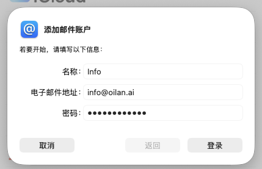
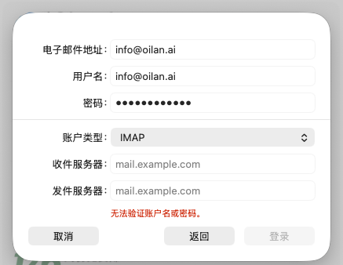
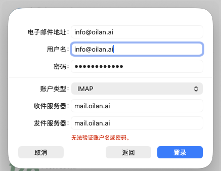
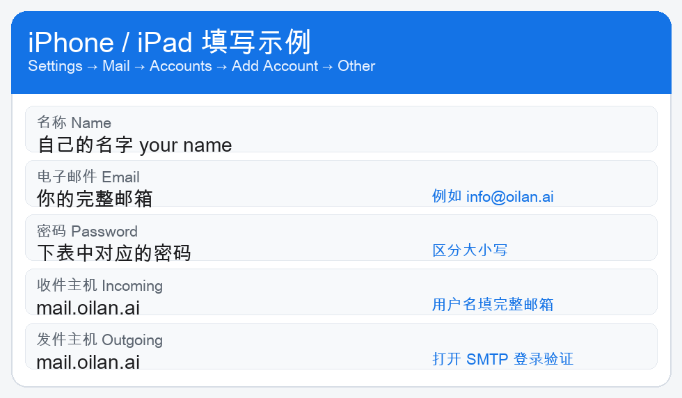
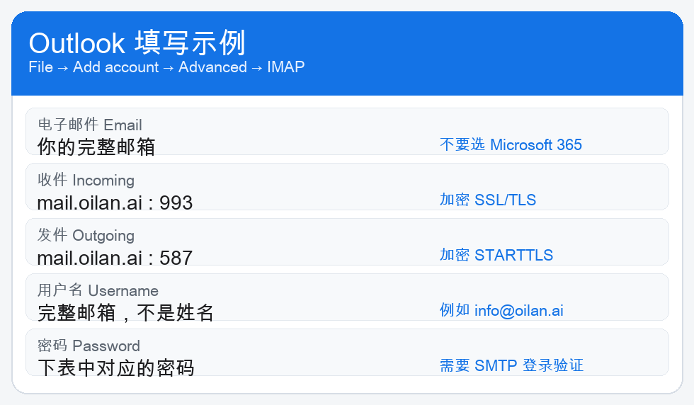
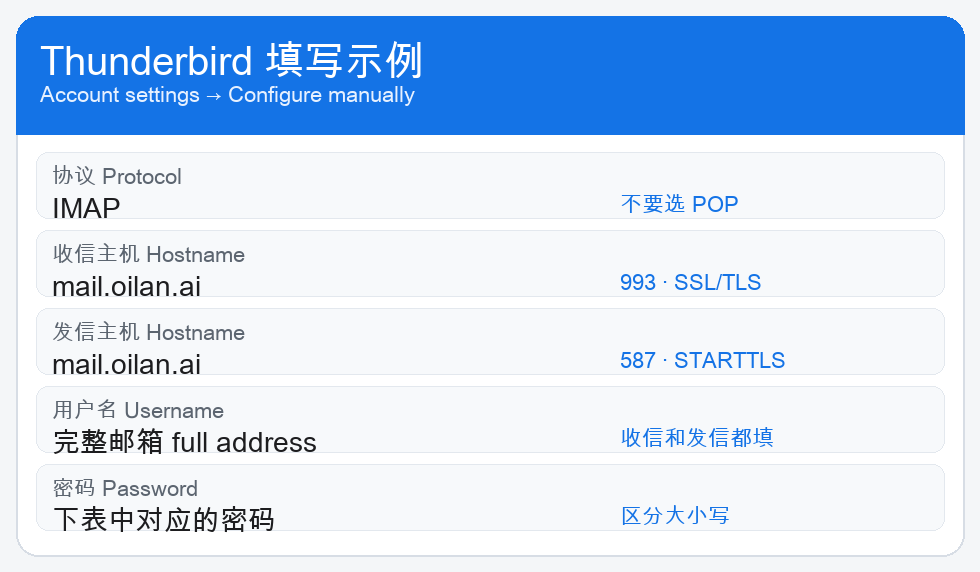

# oilan.ai 邮箱使用手册

这份手册给使用 `@oilan.ai` 邮箱的人。下面有你的邮箱和密码。请只登录自己的那一行，不要使用同事的密码。

Your mailbox and password are in the table below. Sign in only with your own row.

密码必须和表里完全一样，区分大小写，前后不要有空格。邮箱地址用小写即可。

The password is case-sensitive and must match the table exactly. The address can be lowercase.

## 你的邮箱和密码

| 邮箱 Email | 密码 Password | 说明 |
| --- | --- | --- |
| `baurzhan.nurahan@oilan.ai` | `baurzhan.nurahan` | |
| `gulnar.kanat@oilan.ai` | `gulnar.kanat` | |
| `nurzhamal.makulbekova@oilan.ai` | `Nurzhamal.makulbekova` | 密码里有大写字母 |
| `moldabayev.alisher@oilan.ai` | `Moldabayev.Alisher` | 密码里有大写字母 |
| `yermek.abilgaziyev@oilan.ai` | `yermek.abilgaziyev` | |
| `info@oilan.ai` | `Oilan@123456` | 公共邮箱 |
| `kuanysh.adil@oilan.ai` | `Kuanysh.Adil` | 密码里有大写字母 |
| `support@oilan.ai` | `support` | 收信会同时抄送给同事 |
| `ai@oilan.ai` | `Ab123456` | |

用户名永远填完整邮箱，例如 `info@oilan.ai`。不要只填姓名。

The username is always the full address, for example `info@oilan.ai`. Do not enter only a name.

## 所有软件都用这一套

Apple 邮件、iPhone 邮件、Outlook、Thunderbird 都填下面这五项。Foxmail、QQ 邮箱、网易邮箱大师也用这一套，选择“其他邮箱”或 IMAP，不要用 QQ 号或网易号登录。

| 用途 | 主机 | 端口 | 加密 |
| --- | --- | --- | --- |
| 收信 IMAP | `mail.oilan.ai` | 993 | SSL/TLS |
| 发信 SMTP | `mail.oilan.ai` | 587 | STARTTLS |
| 发信也可以 | `mail.oilan.ai` | 465 | SSL/TLS |

证书名称是 `*.oilan.ai`。系统如果询问是否信任，确认是这个名称后再继续。

## 在 Mac 系统“邮件”里添加

下面四张图都是这台 Mac 上“邮件”的真实界面。例子用的是 `info@oilan.ai`。你把自己的邮箱和密码换进去。

### 1. 打开添加账户

打开“邮件”。点屏幕最上方菜单栏的“邮件”，选择“添加账户…”。

Open Mail. In the menu bar choose Mail → Add Account.

### 2. 选最下面的“其他邮件账户”

不要选 iCloud、Microsoft Exchange、Google、Yahoo、AOL、163、126 或 QQ 邮箱。列表往下，点最后一项「其他“邮件”账户」。

不要点“继续”。那个按钮会按地址猜测服务商，猜不到就会失败。

Do not choose iCloud, Exchange, Google, Yahoo, AOL, 163, 126, or QQ Mail. Scroll to the bottom and choose Other Mail Account. Do not click Continue.

### 3. 填写姓名、邮箱和密码

名称填你的名字。电子邮件地址填完整邮箱。密码填上表里你自己的密码，输入后显示为圆点。然后点“登录”。

Name is your display name. Email and the later username are the full address. Password comes from your row in the table.

### 4. 把 mail.example.com 改掉

下一页账户类型保持 IMAP。如果收件服务器和发件服务器是 `mail.example.com`，登录会失败，并出现红色字“无法验证账户名或密码”。

Keep IMAP. If the servers still say `mail.example.com`, login fails with “Unable to verify account name or password.”

把这四项改成：

- 电子邮件地址：你的完整邮箱
- 用户名：同一个完整邮箱。如果这里是空的，或写着“自动”，一定改成完整邮箱
- 收件服务器：`mail.oilan.ai`
- 发件服务器：`mail.oilan.ai`

改完后点蓝色的“登录”。图里的红色提示是上一次还填着 `mail.example.com` 时留下的，字段改对后再点一次登录。

账户出现在左侧边栏后，就可以收信和发信。

## 在 iPhone 或 iPad 上添加

1. 打开“设置” → “邮件” → “账户” → “添加账户”。
2. 选“其他”，再点“添加邮件账户”。不要选 iCloud、Exchange、Google、Yahoo 或 Outlook。
3. 名称、电子邮件、密码按上表填写。
4. 下一步选 IMAP。
5. 收件服务器主机名填 `mail.oilan.ai`，用户名填完整邮箱。
6. 发件服务器主机名也填 `mail.oilan.ai`，用户名和密码再填一次。
7. 只保存“邮件”，然后点“存储”。

On iPhone or iPad: Settings → Mail → Accounts → Add Account → Other → Add Mail Account. Choose IMAP. Both host names are `mail.oilan.ai`.

## 在 Outlook 里添加

1. 打开 Outlook，选择“文件” → “添加账户”。
2. 点“高级设置”或“手动设置”，选择 IMAP。不要选 Microsoft 365 或 Exchange。
3. 按下面填写。用户名是完整邮箱。
4. 发信打开“SMTP 需要身份验证”或 “My outgoing server requires authentication”。
5. 保存后发一封信给自己，确认能收到。

Outlook: File → Add Account → Advanced setup → IMAP. Do not choose Microsoft 365.

## 在 Thunderbird 里添加

1. 新建账户，选择“电子邮件”。
2. 填完整邮箱和密码后，点“手动配置”。不要用自动查找的结果。
3. 收信协议选 IMAP，主机 `mail.oilan.ai`，端口 993，连接安全性 SSL/TLS。
4. 发信主机 `mail.oilan.ai`，端口 587，连接安全性 STARTTLS。也可以用 465 和 SSL/TLS。
5. 收信和发信的用户名都填完整邮箱，然后点“完成”。

Thunderbird: create an email account, then choose Configure manually. Do not accept the automatic lookup.

## 收信和发信

收信使用 IMAP。邮件留在服务器上，手机和电脑看到的是同一封信。

发信必须登录。发件人要和登录的邮箱一致。

写给 `support@oilan.ai` 的信会留在 support 邮箱里，并同时出现在这些邮箱中：`baurzhan.nurahan`、`gulnar.kanat`、`nurzhamal.makulbekova`、`moldabayev.alisher`、`yermek.abilgaziyev`、`info`、`kuanysh.adil`。不需要发信人再逐个添加收件人。`ai@oilan.ai` 不在这份抄送名单里。

Mail sent to `support@oilan.ai` stays in support and is also copied to those seven mailboxes. `ai@oilan.ai` is not on that copy list.

## 遇到问题时

| 现象 | 处理 |
| --- | --- |
| 提示密码错误或无法验证 | 用户名改成完整邮箱，服务器改成 `mail.oilan.ai`，再重新输入表里的密码。 |
| 服务器是 `mail.example.com` | 收件和发件都改成 `mail.oilan.ai`。 |
| 选成了 QQ、163、Gmail 或 iCloud | 返回，改选“其他邮件账户”或 IMAP。 |
| 能收信但不能发信 | 发件端口用 587 和 STARTTLS，或 465 和 SSL/TLS，并打开 SMTP 登录验证。 |
| 证书提示 | 确认名称是 `*.oilan.ai` 后再信任。 |
