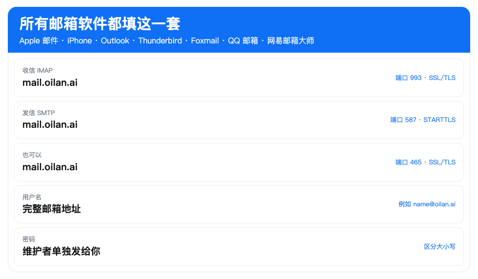
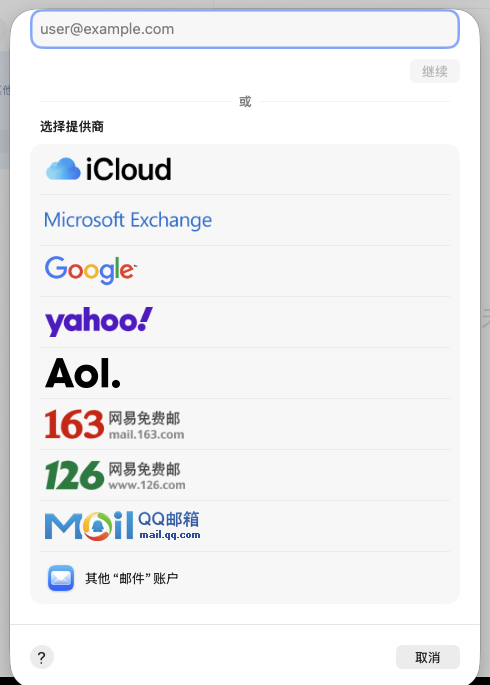
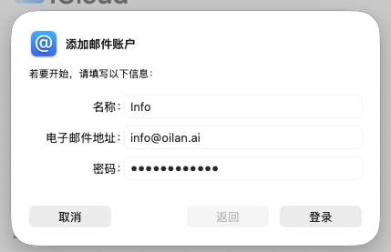
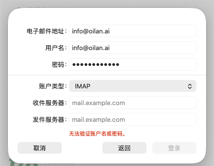
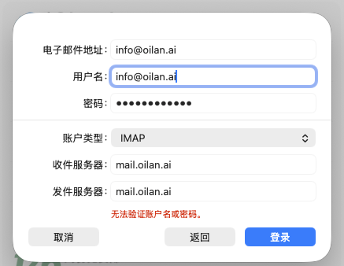
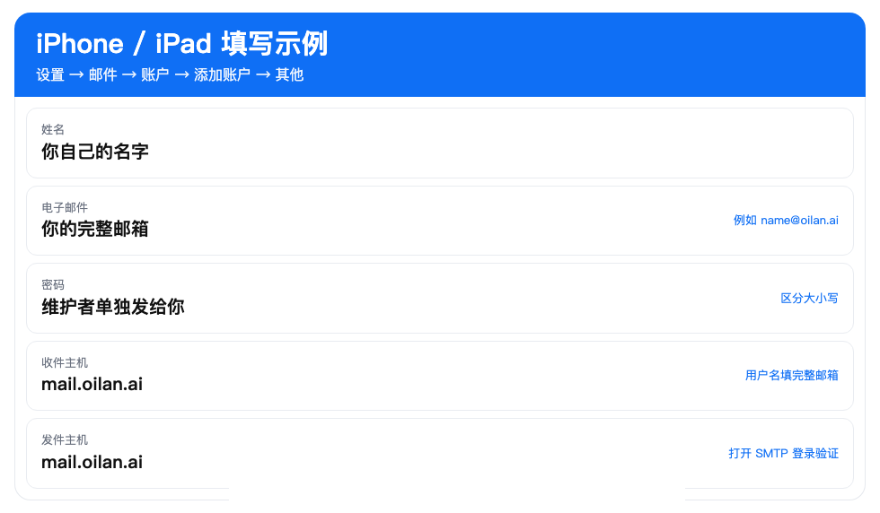
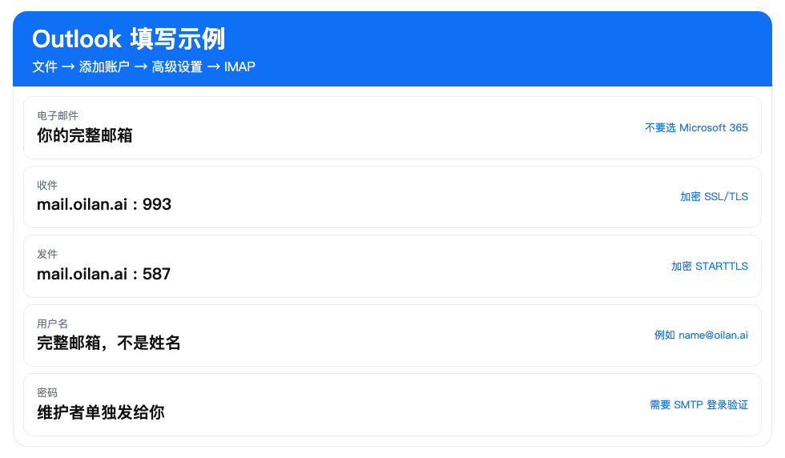
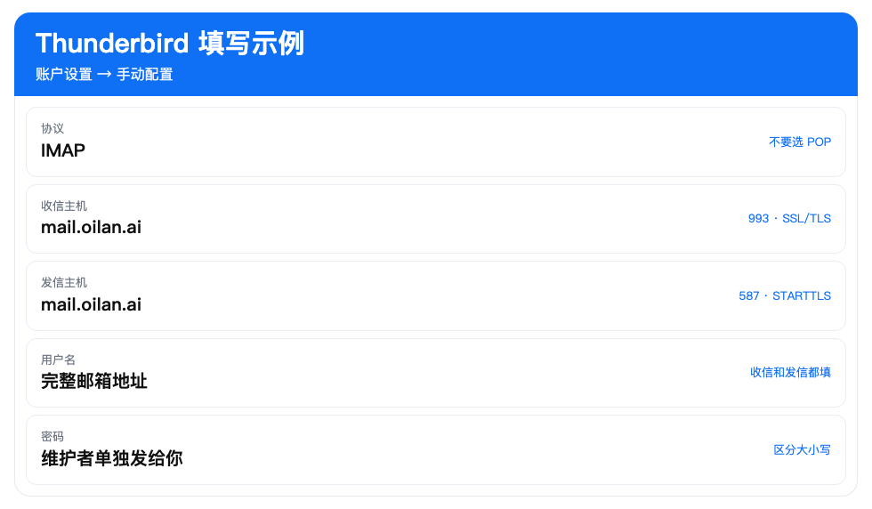

# oilan.ai 邮箱使用手册（中文）

> 这份手册说明怎么在电脑和手机上收发 **@oilan.ai** 邮箱。
>
> 本手册不含密码。邮箱地址和密码由维护者单独发给你，请只登录自己的账号。
>
> 哈萨克文版：**oilan-ai.kk.pdf**，在同一目录下。

## 一、你的账号

- 邮箱地址：完整地址，例如 **name@oilan.ai**；以维护者单独发给你的为准，本手册不列名单。
- 用户名：每次登录都要填完整邮箱，不要只填姓名。
- 密码：不在本手册里，由维护者单独发送。密码区分大小写，前后不要有空格。
- 忘记密码、或需要请同事代看邮件：联系维护者处理，不要借别人的密码登录。

## 二、服务器设置

所有客户端都用这一套：Apple 邮件、iPhone / iPad、Outlook、Thunderbird、Foxmail、QQ 邮箱、网易邮箱大师。选「其他邮箱」或 IMAP，不要用 QQ 号、163 账号或网易账号直接登录。

| 用途 | 主机 | 端口 | 加密 |
| --- | --- | --- | --- |
| 收信 IMAP | **mail.oilan.ai** | 993 | SSL/TLS |
| 发信 SMTP | **mail.oilan.ai** | 587 | STARTTLS |
| 发信 SMTP（备用） | **mail.oilan.ai** | 465 | SSL/TLS |

{.card}

- 用户名填完整邮箱地址。
- 发信必须打开「SMTP 登录验证」或「服务器需要身份验证」。
- 端口和加密方式要成对使用：993 配 SSL/TLS，587 配 STARTTLS，465 配 SSL/TLS。
- 证书名称是 **\*.oilan.ai**。系统询问是否信任时，确认名称后再继续。

## 三、在 Mac「邮件」里添加

1. 打开「邮件」，在菜单栏选择「邮件」→「添加账户…」。
2. 在列表最下面点「其他“邮件”账户」。不要选 iCloud、Microsoft Exchange、Google、Yahoo、AOL、163、126 或 QQ 邮箱。不要点「继续」，这个按钮会按地址猜服务商，猜不到就会失败。

{.shot}

3. 填写名称、完整邮箱和维护者给你的密码，然后点「登录」。

{.shot}

4. 下一页账户类型保持 IMAP。如果收件服务器和发件服务器还是 **mail.example.com**，登录会失败，并出现红字「无法验证账户名或密码」。

{.shot}

把这四项改成：

| 字段 | 要填的值 |
| --- | --- |
| 电子邮件地址 | 你的完整邮箱 |
| 用户名 | 同一个完整邮箱；空的或写着「自动」都要改掉 |
| 收件服务器 | **mail.oilan.ai** |
| 发件服务器 | **mail.oilan.ai** |

改完再点蓝色的「登录」。图里的红色提示是上一次还填着 **mail.example.com** 时留下的。

{.shot}

5. 账户出现在左侧边栏后，就可以收信和发信。

## 四、在 iPhone 或 iPad 上添加

1. 打开「设置」→「邮件」→「账户」→「添加账户」。
2. 选「其他」，再点「添加邮件账户」。不要选 iCloud、Exchange、Google、Yahoo 或 Outlook。
3. 名称和电子邮件地址按自己的账号填写，密码填维护者发给你的那一个。
4. 下一步选 IMAP。
5. 收件服务器主机名填 **mail.oilan.ai**，用户名填完整邮箱。
6. 发件服务器主机名也填 **mail.oilan.ai**，用户名和密码再填一次。
7. 只保存「邮件」，然后点「存储」。

{.card}

## 五、在 Outlook 里添加

1. 打开 Outlook，选择「文件」→「添加账户」。
2. 点「高级设置」或「手动设置」，选择 IMAP。不要选 Microsoft 365 或 Exchange。
3. 按下面的卡片填写，用户名是完整邮箱。
4. 发信打开「SMTP 需要身份验证」。
5. 保存后给自己发一封信，确认能收到。

{.card}

## 六、在 Thunderbird 里添加

1. 新建账户，选择「电子邮件」。
2. 填完整邮箱和密码后，点「手动配置」。不要用自动查找的结果。
3. 收信协议选 IMAP，主机 **mail.oilan.ai**，端口 993，连接安全性 SSL/TLS。
4. 发信主机 **mail.oilan.ai**，端口 587，连接安全性 STARTTLS。也可以用 465 和 SSL/TLS。
5. 收信和发信的用户名都填完整邮箱，然后点「完成」。

{.card}

## 七、收信和发信

- 收信使用 IMAP。邮件留在服务器上，手机和电脑看到的是同一封信。
- 发信必须登录。发件人要和你登录的邮箱一致。
- 写给 **support@oilan.ai** 的信会留在 support 邮箱里，并同时抄送给 7 位相关同事，发信人不用再逐个添加收件人。

## 八、遇到问题时

| 现象 | 处理 |
| --- | --- |
| 提示密码错误或无法验证 | 用户名改成完整邮箱，服务器改成 **mail.oilan.ai**，再输入维护者给你的密码。 |
| 服务器显示 mail.example.com | 收件和发件都改成 **mail.oilan.ai**。 |
| 选成了 QQ、163、Gmail 或 iCloud | 返回，改选「其他邮件账户」或 IMAP。 |
| 能收信但不能发信 | 发件端口用 587 和 STARTTLS，或 465 和 SSL/TLS，并打开 SMTP 登录验证。 |
| 证书提示 | 确认名称是 \*.oilan.ai 后再信任。 |
| 忘记密码 | 联系维护者重置，不要借用同事的账号。 |

## 九、安全提醒

- 密码只发给你本人，不要转给同事，也不要发到群里。
- 不要在公共电脑上勾选「记住密码」。
- 陌生邮件里的链接和附件先不要点开。

---

版本：2026-11-17 · 维护者：邮箱管理员
